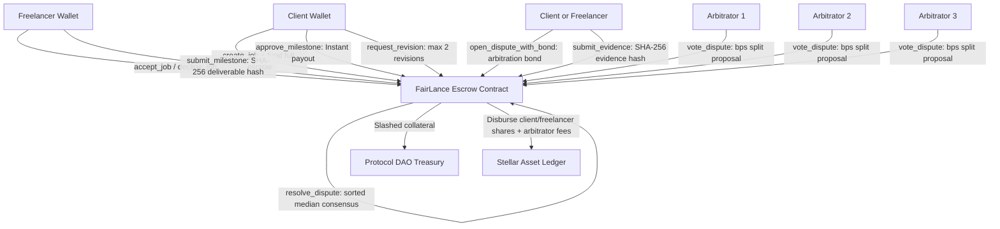
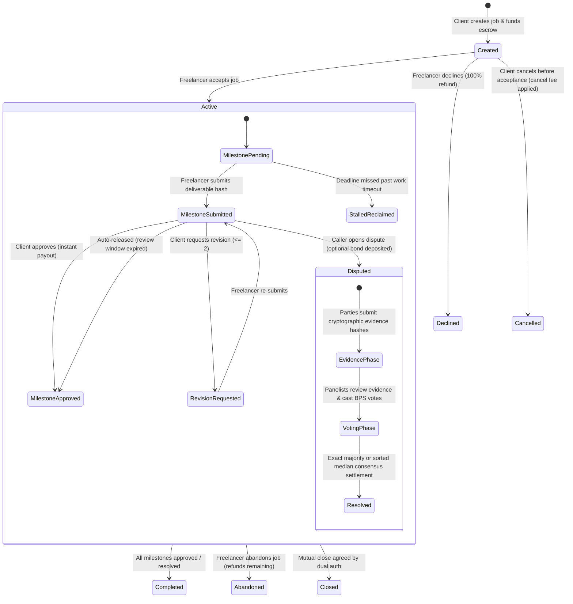

# Gig-escrow-contracts (Escrow-FairLance)

[](https://opensource.org/licenses/MIT)
[](https://github.com/Escrow-FairLance/Gig-escrow-contracts/actions/workflows/ci.yml)
[](https://stellar.org/soroban)
[](https://www.rust-lang.org/)
[](https://webassembly.org/)

> Enterprise-grade decentralized freelancer escrow smart contract protocol built on Stellar Soroban, featuring milestone disbursements, mathematical median-consensus dispute arbitration (1–7 odd panelists), caller dispute bonds, collateral staking, governance slashing, emergency pause controls, and contract upgradeability.

---

## Table of Contents

- [System Architecture](#system-architecture)
- [Escrow & Milestone State Machine](#escrow--milestone-state-machine)
- [Key Security Enhancements & Invariants](#key-security-enhancements--invariants)
  - [1. Continuous Median-Consensus Dispute Resolution](#1-continuous-median-consensus-dispute-resolution)
  - [2. Dispute Bonds & Fee-Griefing Protection](#2-dispute-bonds--fee-griefing-protection)
  - [3. Emergency Circuit Breaker (Pause / Unpause)](#3-emergency-circuit-breaker-pause--unpause)
  - [4. Contract Bytecode Upgradeability](#4-contract-bytecode-upgradeability)
  - [5. Protocol Treasury Collateral Routing](#5-protocol-treasury-collateral-routing)
- [Threat Matrix & Protocol Mitigations](#threat-matrix--protocol-mitigations)
- [Stellar Testnet Deployment Details](#stellar-testnet-deployment-details)
- [Contract Methods Reference](#contract-methods-reference)
- [Developer Quickstart & Verification](#developer-quickstart--verification)
- [Contributing & Community Standards](#contributing--community-standards)
- [License](#license)

---

## System Architecture



---

## Escrow & Milestone State Machine



---

## Key Security Enhancements & Invariants

### 1. Continuous Median-Consensus Dispute Resolution
Unlike naive mode-matching algorithms that fail and force 50/50 splits when panelists cast non-identical basis point votes (e.g. 70%, 80%, 90%), the contract executes an in-place sorted **median consensus**:
- Exact majority ($\ge (N/2) + 1$ identical votes) settles immediately.
- If deadline passes or all panelists vote with varied percentages, the contract sorts all cast basis points ascending and determines the median:
  $$\text{Settled BPS} = \begin{cases} \text{votes}[N/2] & \text{if } N \text{ is odd} \\ \frac{\text{votes}[N/2 - 1] + \text{votes}[N/2]}{2} & \text{if } N \text{ is even} \end{cases}$$
- Outlier and biased votes are neutralised mathematically without defaulting to false ties.

### 2. Dispute Bonds & Fee-Griefing Protection
- In standard escrow contracts, arbitrator fees are deducted from the milestone principal, creating an attack vector where a disgruntled client can open a frivolous dispute and force the freelancer to lose up to 30% in arbitrator fees even if the freelancer wins 100%.
- Through `open_dispute_with_bond`, the dispute initiator deposits an arbitration fee bond. When the dispute is resolved in favor of the defendant ($\ge 5000$ BPS for freelancer), the bond pays the panel fees and the defendant receives their full unpenalized milestone earnings.

### 3. Emergency Circuit Breaker (Pause / Unpause)
- Admin can trigger `set_paused(admin, true)` to halt `create_job` and `stake_arbitrator` operations during zero-day investigations or upstream asset incidents while preserving existing milestone release and mutual close operations.

### 4. Contract Bytecode Upgradeability
- Implements the official Soroban contract upgrade pattern via `env.deployer().update_current_contract_wasm(new_wasm_hash)`.
- Allows authorized protocol governance to deploy audited patches to contract logic without migrating ledger balances or disrupting active escrows.

### 5. Protocol Treasury Collateral Routing
- Slashed collateral from non-voting or malicious arbitrators is routed to a configured DAO treasury address (`set_treasury`) rather than personal admin accounts, eliminating centralization risks.

---

## Threat Matrix & Protocol Mitigations

| Threat Vector | Attack Scenario | Contract Mitigation |
| :--- | :--- | :--- |
| **Arbitrator Collusion** | Panelists coordinate unfair payout. | Arbitrators must stake tokens (`stake_arbitrator`). Panels are strictly odd-sized (1–7) with non-party exclusion. Slashed collateral is routed to DAO treasury. |
| **Deliverable Tampering** | Contractor submits corrupted files. | Deliverables are cryptographically anchored as SHA-256 hashes (`submit_milestone`) matching off-chain storage bundles. |
| **Fee Griefing Extortion** | Client opens dispute to haircut earnings. | Initiator deposits arbitration bond (`open_dispute_with_bond`). Prevailing party receives full unpenalized principal. |
| **Client Ghosting** | Client disappears without reviewing work. | Guaranteed time-decay auto-release (`auto_release`) triggers payout after `review_window_seconds`. |
| **Freelancer Ghosting** | Contractor accepts job but never delivers. | Client reclaims remaining escrow (`reclaim_stalled`) once `milestone.deadline + work_timeout_seconds` elapses. |
| **Endless Revision Demands** | Client demands infinite rework. | Hard cap of maximum 2 revisions per milestone (`MaxRevisionsExceeded`). On 3rd dissatisfaction, dispute must be opened. |
| **Non-Voting Panelists** | Arbitrators abandon dispute voting. | Non-voting arbitrators forfeit fees and suffer automatic 10% collateral slashing (`emit_arbitrator_slashed`). |
| **Zero-Day Vulnerability** | Exploited token contract or runtime bug. | Admin can trigger emergency pause (`set_paused`) and deploy audited bytecode upgrade (`upgrade`). |

---

## Stellar Testnet Deployment Details

- **Network Passphrase**: `Test SDF Network ; September 2015`
- **Soroban RPC URL**: `https://soroban-testnet.stellar.org`
- **Contract ID**: `CCFJLJRJWMA6EG3N3X3EK7UN3OPKN3YKOAR4T53KSXOSRDJWT473HMAY`
- **Native XLM Contract**: `CDLZFC3SYJYDZT7K67VZ75HPJVIEUVNIXF47ZG2FB2RMQQVU2HHGCYSC`
- **Deployer / Admin**: `GB6CML3GZYGJ4BLR2PK5QTKQIF6KTT56ZXXTIHXTWG4JAPB3RKDVQTU4`

---

## Contract Methods Reference

### Core Lifecycle
- `initialize(admin: Address)`: Set protocol administrator.
- `create_job(client, freelancer, token, milestones, terms, arbitrator_panel)`: Deposit milestone total into escrow (pause-guarded).
- `accept_job(job_id)`: Freelancer commits to terms and milestones.
- `decline_job(job_id)`: Freelancer declines; 100% refund to client.
- `cancel_unaccepted(job_id)`: Client cancels before acceptance (applies cancellation fee if set).
- `submit_milestone(job_id, milestone_index, deliverable_hash)`: Anchors file SHA-256.
- `approve_milestone(job_id, milestone_index)`: Client releases milestone funds immediately.
- `request_revision(job_id, milestone_index, feedback_hash)`: Request milestone rework (max 2).
- `auto_release(job_id, milestone_index)`: Permissionless release upon review window expiry.
- `reclaim_stalled(job_id, milestone_index)`: Client reclaims escrow if work deadline + timeout passes.
- `abandon_job(job_id)`: Freelancer surrenders job; refunds remaining escrow.
- `mutual_close(job_id, client_amount, freelancer_amount)`: Dual-authenticated payout settlement.

### Arbitration & Staking
- `stake_arbitrator(arbitrator, token, amount)`: Collateral deposit to qualify for panels (pause-guarded).
- `unstake_arbitrator(arbitrator, token, amount)`: Unstake tokens if no active panels remain.
- `slash_arbitrator(admin, arbitrator, token, amount, reason)`: Governance slash routed to protocol treasury.
- `open_dispute(job_id, milestone_index, caller, reason_hash)`: Freezes milestone in dispute.
- `open_dispute_with_bond(job_id, milestone_index, caller, reason_hash, bond_amount)`: Opens dispute with fee bond protection.
- `submit_evidence(job_id, milestone_index, submitter, evidence_hash)`: Anchor audit proof.
- `vote_dispute(job_id, milestone_index, arbitrator, freelancer_share_bps)`: Panel vote in bps (0..10000).
- `resolve_dispute(job_id, milestone_index)`: Executes exact majority or sorted median consensus settlement.

### Governance & Protocol Controls
- `upgrade(admin, new_wasm_hash)`: Deploys audited bytecode upgrade via Soroban deployer.
- `set_paused(admin, paused)`: Activates or deactivates emergency circuit breaker.
- `is_paused()`: Returns current pause state.
- `set_treasury(admin, treasury)`: Sets DAO treasury address for slashed penalties.
- `get_treasury()`: Returns configured treasury address.

---

## Developer Quickstart & Verification

### Prerequisites
- Rust $\ge 1.80$ with target `wasm32-unknown-unknown`
- Stellar CLI $\ge 22.0$
- Node.js $\ge 20$

### 1. Build WebAssembly Contract
```bash
cargo build --target wasm32-unknown-unknown --release
```
Compiled WASM output is generated at:
```
target/wasm32-unknown-unknown/release/gig_escrow_contracts.wasm
```

### 2. Verify Code Quality & Lints
```bash
# Check code formatting
cargo fmt -- --check

# Run Clippy lints
cargo clippy --all-targets -- -D warnings

# Verify all unit tests compile
cargo check --tests
```

### 3. Build TypeScript SDK Bindings
```bash
npm run bindings:build
```

### 4. Run End-to-End Testnet Lifecycle
```bash
cp .env.example .env
npm run e2e
```

---

## Contributing & Community Standards

Contributions from Web3 developers are welcome! Please review:
- [Contributing Guidelines](CONTRIBUTING.md): Code style, commit conventions, and PR checklist.
- [Code of Conduct](CODE_OF_CONDUCT.md): Contributor Covenant v2.1 standards.
- [Security Policy](SECURITY.md): Vulnerability disclosure procedures and bug bounty criteria.

---

## License

This project is licensed under the [MIT License](LICENSE).
